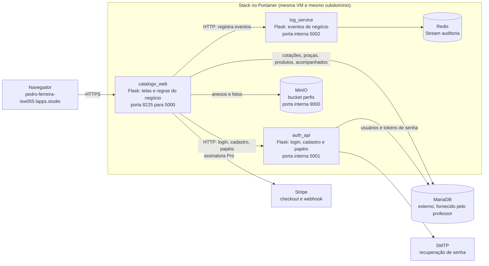

# CotaAgro

Projeto da disciplina do professor [@siriani](https://github.com/siriani). Evolução do repositório [CatalogoFilmes](https://github.com/PedroBarbosa42/CatalogoFilmes), do qual este repositório herda todo o histórico de commits.

**Sistema no ar:** [https://pedro-ferreira-isw055.lapps.studio/](https://pedro-ferreira-isw055.lapps.studio/)

---

## 1. Nome e frase

**CotaAgro**: compara os preços de soja, milho e insumos de cooperativas e cerealistas num só lugar e avisa o produtor rural quando o preço chega no valor que ele quer.

## 2. A dor

**Quem sofre:** o produtor rural pequeno e médio, que vende grãos (soja, milho, trigo) e compra insumos (adubo, defensivos, sementes) de várias cooperativas e cerealistas.

**Quando:** toda vez que vai vender a safra ou comprar insumos. O preço muda de um dia para o outro e de uma praça para outra.

**Quanto custa hoje:**
- **Tempo:** ligar ou mandar mensagem para vários compradores antes de decidir, muitas vezes todo dia na época de venda.
- **Dinheiro:** vender no dia errado ou na praça errada significa receber menos por saca. Em uma safra inteira, uma diferença pequena por saca vira um valor grande.
- **Risco:** decidir sem histórico, sem saber se o preço do dia está acima ou abaixo da média do mês.

**Como resolve hoje:** grupos de WhatsApp, ligações para cooperativas e cerealistas, boletins de cotação nacionais e, no melhor caso, uma planilha própria.

## 3. Persona

**Seu Carlos, 52 anos, produtor de soja e milho em 120 hectares.**

Ele acorda cedo, olha o clima e, antes de decidir se vende parte da safra, liga para 3 lugares e confere dois grupos de WhatsApp. Cada um passa um preço em um horário diferente, e ele nunca tem certeza de que está vendendo bem. O que ele quer é saber quando o preço da saca passa do valor que ele tem em mente e ver se hoje está acima ou abaixo da média do mês. O que atrapalha: informação espalhada, sem histórico e sem aviso.

## 4. Concorrentes e alternativas

1. **Grupos de WhatsApp:** os produtores e compradores passam preços entre si. *O que faz mal:* a informação é solta, sem padrão e sem histórico, e é difícil comparar.
2. **Ligar para cooperativas e cerealistas:** dá o preço direto da fonte. *O que faz mal:* é demorado, repetitivo e não compara nada automaticamente.
3. **Sites e apps de cotação nacional** (ex.: Notícias Agrícolas, Canal Rural, CEPEA): mostram cotações de mercado e de praças de referência. *O que faz mal:* o preço é geral, não é o da cooperativa e da cerealista onde o produtor realmente vende.
4. **Planilha própria:** controle manual dos preços. *O que faz mal:* dá trabalho, não avisa nada e só funciona se alguém digitar.

## 5. Proposta de valor

O preço **da sua praça**, comparado entre compradores e com alerta, em vez de o produtor correr atrás de cada cotação.

## 6. Modelo de receita com Stripe

| | **Free** | **Pro, R$ 19,90/mês** |
|---|---|---|
| Cotações do dia | sim | sim |
| Produtos acompanhados | até 3 | ilimitados |
| Alertas de preço | não | sim |
| Histórico de preços | 7 dias | completo |

**O que o Free limita:** o número de produtos acompanhados (3), os alertas (não incluídos) e o histórico (7 dias).

**Por que alguém pagaria o Pro:** o alerta evita a rotina de ligar e conferir todo dia, e o histórico completo mostra o melhor momento de vender. Se o aviso ajuda a vender uma única saca por um preço melhor, o plano já se paga. O preço é uma hipótese inicial e será validado com os primeiros usuários.

Cobrança recorrente via **Stripe** (modo de teste durante o desenvolvimento), sem guardar dados de cartão no sistema: apenas IDs de cliente e assinatura.

## 7. Métricas de sucesso

- **Cadastros** (produtores e operadores) por semana
- **Assinantes Pro** e a conversão de Free para Pro
- **MRR** (receita recorrente mensal)
- **Retenção mensal** dos assinantes
- **Alertas disparados** por usuário (mostra se o recurso principal é usado)
- **Frequência de atualização** das cotações pelos operadores

## 8. Lean Canvas

| Bloco | CotaAgro |
|---|---|
| **Problema** | 1) Preços espalhados em várias fontes, difíceis de comparar. 2) Sem aviso quando o preço chega no valor desejado. 3) Sem histórico para decidir o melhor momento de vender ou comprar. *Hoje:* WhatsApp, telefone, planilha. |
| **Segmentos de clientes** | Produtores rurais pequenos e médios de grãos. *Primeiros a adotar:* produtores de uma região específica que já vendem para cooperativas e cerealistas locais e já usam WhatsApp para consultar preço. |
| **Proposta única de valor** | O preço da sua praça, comparado entre compradores e com alerta. |
| **Solução** | 1) Painel de cotações por produto e praça. 2) Alertas de preço por valor-alvo. 3) Histórico de preços. |
| **Canais** | Grupos de WhatsApp de produtores, cooperativas e cerealistas parceiras, indicação de produtor para produtor, sindicatos rurais, landing page. |
| **Fontes de receita** | Assinatura Pro mensal (R$ 19,90) via Stripe. No futuro: plano para cooperativas e cerealistas que queiram destaque. |
| **Estrutura de custos** | Infraestrutura (já existente: Portainer, MariaDB, Redis, MinIO), taxas do Stripe por transação, tempo de desenvolvimento e de relacionamento com os operadores. |
| **Métricas-chave** | Cadastros, assinantes Pro, MRR, retenção, alertas disparados. |
| **Vantagem injusta** | Relacionamento direto com cooperativas e cerealistas que publicam os preços e o histórico local acumulado, que não existe nas cotações nacionais. |

> **Sobre o foco geográfico:** o produto é pensado para funcionar em qualquer região do Brasil, mas o primeiro foco será uma região só. Cotação é um dado local, e o valor do produto depende de ter os preços reais das cooperativas e cerealistas daquela praça. Começar por uma região permite validar a dor e conseguir os primeiros operadores antes de expandir.

---

## Mapa de reaproveitamento

| Peça do projeto anterior | O que virou no SaaS | No CotaAgro |
|---|---|---|
| Catálogo de filmes (TMDB) | Recurso principal do negócio | **Cotações**: produto, praça (cooperativa ou cerealista), preço, unidade e data |
| Microsserviço de login + RBAC | Papéis do negócio | `produtor` (padrão), `operador` (publica preços da própria praça) e `admin` |
| Logs e auditoria (`log_service`, Redis Streams) | Eventos de negócio | `cotacao_publicada`, `cotacao_atualizada`, `cotacao_removida`, `praca_criada`, `produto_acompanhado`, além de login e acesso negado |
| Upload e perfil (MinIO) | Arquivos do domínio | **Tabela de preços** (PDF ou imagem) anexada à cotação, além da foto de perfil |
| Plano Premium (Stripe) | Assinatura | Plano Pro (alertas e histórico). A integração com Stripe foi mantida e será adaptada na atividade 11 |
| Favoritos e "assistir depois" (limite de 3 no plano comum) | Itens acompanhados | **Produtos acompanhados**: Free até 3, Pro ilimitado |

## Arquitetura

O sistema roda como uma única stack no Portainer, no mesmo subdomínio de sempre. O banco MariaDB é externo à stack.

| De | Para | Para quê |
|---|---|---|
| Navegador | `catalogo_web` | Todas as telas e rotas do sistema |
| `catalogo_web` | `auth_api` | Cadastro, login, listagem de usuários, troca de papel e exclusão |
| `catalogo_web` | `log_service` | Registro de eventos de negócio (envio assíncrono, não bloqueia a tela) |
| `log_service` | Redis | Grava os eventos no stream `auditoria`; o admin consulta em `/admin/logs` |
| `catalogo_web` | MinIO | Upload e leitura da tabela de preços das cotações e da foto de perfil |
| `catalogo_web` e `auth_api` | MariaDB | Tabelas do domínio e de usuários |
| `catalogo_web` | Stripe | Checkout do plano Pro (atividade 11 conclui a adaptação) |

Serviços em `docker-compose.yml`: `catalogo_web`, `auth_api`, `log_service`, `redis` e `minio`. Só o `catalogo_web` publica porta (`8225:5000`); os demais ficam acessíveis apenas dentro da rede da stack.

## Banco de dados

O script [`db/001_dominio.sql`](db/001_dominio.sql) faz a migração e o seed. Quem clonar o repositório recria o domínio rodando esse arquivo no banco, e ele pode ser executado mais de uma vez sem duplicar dados.

| Tabela | Conteúdo | Relações |
|---|---|---|
| `produtos` | Soja, milho, trigo, ureia, adubo NPK | |
| `pracas` | Cooperativas e cerealistas | `usuario_id` aponta para o operador dono |
| `cotacoes` | Preço, unidade, observação, anexo e data de atualização | `produto_id`, `praca_id` e `usuario_id` |
| `acompanhados` | Produtos que cada usuário acompanha | `usuario_id` e `produto_id` (chave composta) |

O script também troca o papel padrão de `usuarios` para `produtor`. As tabelas de usuários e de tokens de senha vêm do projeto anterior. O seed contém **dados de exemplo** (praças e preços fictícios), usados só para demonstração; as cotações reais são publicadas pelos operadores pela própria tela.

## Papéis, permissões e isolamento

| Papel | O que pode fazer |
|---|---|
| `produtor` (padrão no cadastro) | Consultar e comparar cotações, ver o detalhe, acompanhar produtos (até 3 no Free) |
| `operador` | Tudo do produtor, mais cadastrar a própria praça e **publicar, editar e remover cotações apenas das suas praças** |
| `admin` | Tudo do operador em qualquer praça, mais usuários e papéis, métricas e logs |

**Isolamento:** a **leitura das cotações é pública** entre os usuários logados, porque o produtor precisa comparar os preços de todas as praças. O que é isolado por dono é a **escrita** (publicar, editar e remover) e os **produtos acompanhados**, que são privados de cada usuário. As permissões são conferidas no backend: ação de um papel sem permissão, ou sobre a cotação de outra praça, responde **403** mesmo quando a chamada é feita direto, sem passar pela tela, e a tentativa fica registrada no log como `acesso_negado`.

## Eventos de negócio no log

O admin consulta em `/admin/logs`, com quem fez e quando:

`cotacao_publicada`, `cotacao_atualizada`, `cotacao_removida`, `praca_criada`, `produto_acompanhado`, `produto_desacompanhado`, `limite_atingido`, `acesso_negado`, `login` e `logout`.

## Como rodar

1. Crie o `.env` a partir do `.env.example` (banco, MinIO, e-mail e Stripe).
2. Execute o `db/001_dominio.sql` no banco.
3. Suba a stack: `docker compose up --build -d`.

O banco só aceita conexões vindas da rede onde a stack roda no Portainer, então o deploy é feito por lá: **Stacks > Add stack > Repository**, com este repositório, a referência `refs/heads/main` e o caminho `docker-compose.yml`.

---

Professor: [github.com/siriani](https://github.com/siriani)